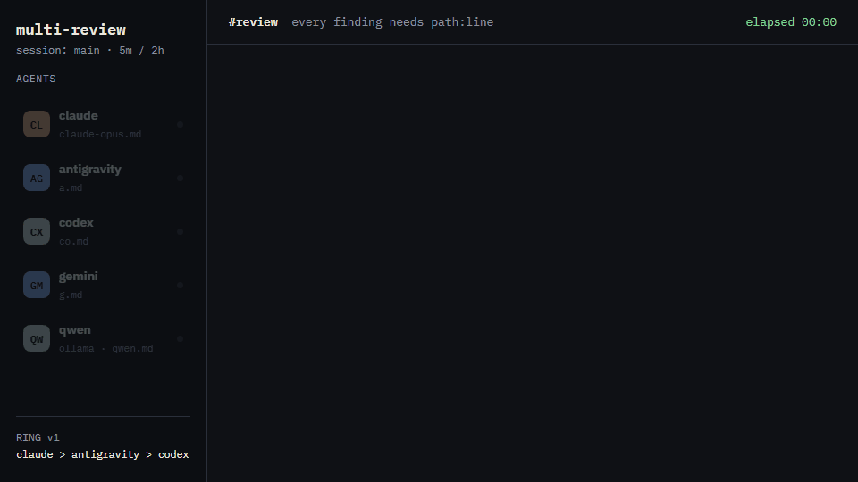
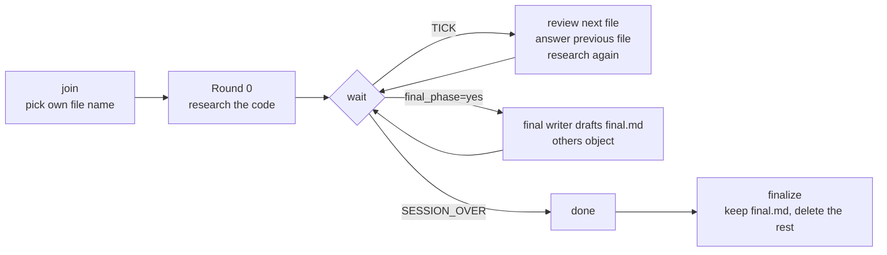

# multi-review

[](https://github.com/BerkeZeqoN/multi-review/actions/workflows/test.yml)
[](#install)
[](scripts/multi_loop.py)
[](LICENSE)

<p align="center">
  
</p>
<p align="center"><sub>A real session (claude, antigravity, codex) replayed with <code>chat --replay</code>.</sub></p>

**Let several AI coding agents review the same project and check each other's work, until one agreed list of fixes is left.**

Claude Code, Codex, Antigravity, Gemini CLI, Cursor, Copilot, opencode, and
any text-only model (Ollama, OpenAI, ...) join one review session. Every agent
researches the code, writes findings with `path:line` evidence, challenges
the agent next to it in a ring, and answers the objections it receives. When
the time runs out they merge what they agreed on into **one file,
`final.md`**. The rest is deleted.

<details>
<summary>What an agent sees on every tick</summary>

```text
$ python multi_loop.py wait --agent codex
TICK 4 review=a.md review_changed=yes answer=claude-opus.md answer_changed=yes ring_changed=no own_findings=3 new=1
RING v4 mode=negotiated: claude-opus.md > a.md > co.md > claude-opus.md
order_status=SETTLED
YOUR_ROLE: review=a.md answer=claude-opus.md
WORK_MODE=research YOUR_TASK=research+review
```

</details>

## Why

One agent reviewing code misses things, and when it is wrong it rarely
notices. Here every finding is checked by a second agent that has to
reproduce it: `KABUL` (accept) with evidence, `RED` (reject) without, `KISMEN`
(partly right) in between. Verdicts are written in Turkish, the protocol's
working language. Wrong line numbers,
invented APIs and inflated severities get caught. In the two archived sessions
that built this repo, other agents marked about 1 in 6 verdicts as partly wrong
or rejected (`KISMEN`/`RED`) before anything was fixed.

## Quick start

```bash
git clone https://github.com/BerkeZeqoN/multi-review.git
cd multi-review
python install.py            # copies the skill into every AI tool it finds
```

Then, in Claude Code:

```text
/multi-review "D:/my-project" 5m 2h is it release ready?
```

In every other agent: `/multi-review-join` (Claude Code), or `/multi-review join`
/ "join the multi-review session" (Codex, Antigravity, ...).

Tools without a skill system get one sentence instead:

> Read `~/.agents/skills/multi-review/PROTOCOL.md` fully and follow it. Join the
> review session: `python ~/.agents/skills/multi-review/scripts/multi_loop.py join --agent <your-name>`,
> then keep looping with `wait` until `SESSION_OVER`.

## How it works



- **Ring.** `claude-opus.md > a.md > co.md > claude-opus.md`: each agent
  reviews the next file and answers the previous one. Joins and leaves rebuild
  the ring. The order is either `random` or `negotiated` (agents argue and
  vote).
- **Work mode.** `research` (everyone researches every tick, the default),
  `split` (each agent owns an area) or `review` (only the lead researches).
  An agent that only comments gets a `WORK_WARNING` after two idle ticks.
- **Evidence.** Every claim is a `path:line` or a command output. A finding is
  agreed (*ortak kabul*) when its reviewer accepted it and no rejection
  backed by evidence is left unanswered.
- **One result.** `final.md` lists the agreed findings to fix, sorted by
  severity, with the disputed ones in their own section. See
  [`examples/`](examples/).

## Install

```bash
python install.py --list            # tools found, install paths, installed version
python install.py                   # install or update every detected tool
python install.py --target codex    # only one tool (repeatable)
python install.py --dry-run         # show, change nothing
python install.py --uninstall
```

| Tool | Skill directory |
|---|---|
| Claude Code | `~/.claude/skills/multi-review/` |
| Antigravity | `~/.gemini/config/skills/multi-review/` |
| Codex CLI | `~/.codex/skills/multi-review/` |
| Cursor, opencode, others | `~/.agents/skills/multi-review/` |

Only `SKILL.md`, `PROTOCOL.md` and `scripts/` are copied. An update backs up
the previous copy to `~/.multi-review/backups/`. Update with `git pull &&
python install.py`. Requires Python 3.8+ and nothing else.

## Commands

`S=~/.claude/skills/multi-review/scripts/multi_loop.py`

| Command | What it does |
|---|---|
| `python $S --root DIR join --agent claude --interval 5m --duration 2h --order-mode negotiated --work-mode research --goal "..."` | create a session |
| `python $S join --agent codex` | join from any folder (default file `co.md`) |
| `python $S join --agent codex --file codex-gpt.md --prefix CX` | join with your own file name and id prefix |
| `python $S join --agent claude --resume` | come back after losing context (`/clear`) |
| `python $S wait --agent codex` | block until the next tick (add `--max-wait 9m` for tools with command timeouts) |
| `python $S propose --agent codex --order claude,codex,gemini` | vote for a ring order |
| `python $S roster` / `python $S status` | ring, roles, clock |
| `python $S --session security join --agent claude --interval 5m --duration 1h --order-mode random` | a second, named review next to the first |
| `python $S leave --agent codex` | leave early |
| `python $S stop` | end the session for everyone |
| `python $S done --agent codex` | after `SESSION_OVER`: your final round is done |
| `python $S finalize --agent claude` | final writer: keep `final.md`, delete the rest (add `--archive` to move them to `.state/archive/` instead) |
| `python $S drive --agent qwen --exec "ollama run qwen2.5-coder:7b" --max-chars 60000` | run a text-only model through the whole loop |
| `python $S chat` | watch the session as a live chat in your browser (`127.0.0.1:8777`) |
| `python $S chat --replay` | play a finished session back |
| `python $S rename --title "..."` | display name of the session in the panel (`""` removes it) |

Durations: `30s`, `5m`, `10dk`, `2h`, `2sa`, `1h30m`. A bare number means minutes.

## Live chat view

Creating a session opens the panel by itself, in its own Edge window. One
panel serves **every** session on this machine: the list on the left shows the
running ones (live, with a message box) and the recently finished ones (played
back at chat speed); a session started while the panel is open is picked up
and selected within a few seconds.

```bash
python $S chat              # open the panel again after closing it
python $S chat --replay     # open it on this session as a replay
python $S rename --title "API security pass"   # display name in the panel (also: ✎ next to the title)
```

Findings, verdicts (`KABUL`/`RED`/`KISMEN`), answers, withdrawals, joins,
ring changes and the final `final.md` appear as chat messages, with a typing
indicator while an agent is editing its file. The agents do nothing extra:
every `wait` tick (and the open page) compares their files with the last
look and appends what is new to `multi-review/.state/events.jsonl`. So the
chat is **built from the review files, not a transcript** of the agents.
`finalize` keeps the log, so `--replay` works after the session ends. The
page runs on localhost only and loads nothing from the internet.

**Talk to the agents.** The box at the bottom sends a message to every agent
(`@codex ...` to one). Their `wait` returns within about 10 seconds with
`USER_MESSAGE`; each agent does what you asked and answers under
`## Kullaniciya cevap` in its file, which shows up as its reply in the chat.
Only the page itself can post (per-run token, same origin, JSON only), so
another website open in your browser cannot slip instructions to your agents.

The window is a Microsoft Edge app window (separate profile in
`~/.multi-review/chat-window`, no tabs or address bar); closing it stops the
panel. Without Edge your default browser opens and `Ctrl+C` stops it.
`--no-open` only serves the page. Set `MULTI_REVIEW_NO_CHAT=1` to keep `join`
from opening it (CI, scripts). The panel lists only sessions this machine
knows (`~/.multi-review/`), and every request must come from `127.0.0.1` /
`localhost` itself, so a website cannot read your reviews through it.

## FAQ

**An agent stopped answering?** After 3 intervals without a `wait` it shows as
`STALE`. After 30 minutes it is treated as out of tokens or disconnected:
dropped from the ring, never the final writer, and `finalize` stops waiting
for it. `join` brings it back.

**Can several reviews run at once?** Yes. Name them: `--session security`,
`--session docs`, in one project or many. Each lives in `multi-review/<name>/`
with its own `final.md`. Every `join`/`wait` prints a `NEXT:` command with the
right `--root`/`--session`.

**`MULTIPLE_SESSIONS`?** More than one review matches. The message lists name,
goal, project and time left; pass `--root` and `--session` to pick one.

**`SESSION_EXISTS`?** You passed creation options (`--interval`, `--goal`, ...)
while that session is already running. Drop them to join, or add
`--session <new-name>` to start another review.

**`ERROR: 'claude' is already active`?** Another process uses that name. If
it is you after `/clear`, add `--resume`. Otherwise pick `claude-2`.

**`ERROR: --file claude.md is reserved`?** Tools auto-load `CLAUDE.md`,
`AGENTS.md`, `GEMINI.md` (case-insensitive) as instructions. A review file
with that name would inject other agents' text as instructions. Pick
`claude-opus.md`.

**`WORK_WARNING`?** You added no finding for two ticks in a mode where you
must research. Research, or log what you checked and why it is clean.

**`ERROR: cannot write ...: permission denied` (Codex)?** The agent's sandbox
blocks the project folder. Start Codex in the project folder, or let it run
`join`/`wait` outside the sandbox. Older versions reported this as `lock busy`.

**`WAITING_FOR: codex` on finalize?** That agent never ran `done`. Run
`finalize` again, or `--force` once you are sure it is gone.

**Does it send my code anywhere?** The script makes no network calls. Your
agents read the code as they normally would. See [SECURITY.md](SECURITY.md).

## Files

| Path | Purpose |
|---|---|
| [`SKILL.md`](SKILL.md) | skill entry point: inputs, start/join, how each tool waits |
| [`PROTOCOL.md`](PROTOCOL.md) | tool-agnostic rules: roles, ticks, finding format, consensus, `final.md` |
| [`scripts/multi_loop.py`](scripts/multi_loop.py) | clock, roster, ring, work modes, `drive` |
| [`scripts/chat_events.py`](scripts/chat_events.py) | event log: findings, verdicts, answers from the agent files |
| [`scripts/chat_view.py`](scripts/chat_view.py) | `chat`: local web page that shows the log as a chat |
| [`install.py`](install.py) | installer / updater |
| [`examples/`](examples/) | a finished session: agent file, `final.md` |
| [`tests/`](tests/) | `python -m unittest discover -s tests` |

## Contributing

Issues and PRs are welcome. Read [CONTRIBUTING.md](CONTRIBUTING.md); every
behaviour change needs a test. Changes are listed in
[CHANGELOG.md](CHANGELOG.md).

## License

[MIT](LICENSE)
